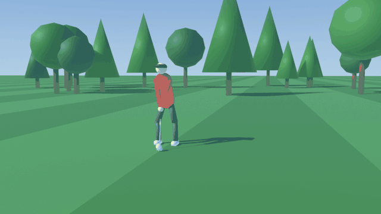
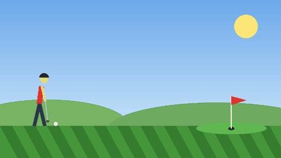

# Golf GIF

An animated hole-in-one, made two ways.

## 3D (Blender)



Built and rendered with Blender's Python API (EEVEE), then assembled into a GIF with Pillow.

```
blender -b --python blender_golf.py -- frames_3d
python make_gif.py
```

## 2D (Pillow)



```
pip install pillow
python render_golf.py
```
